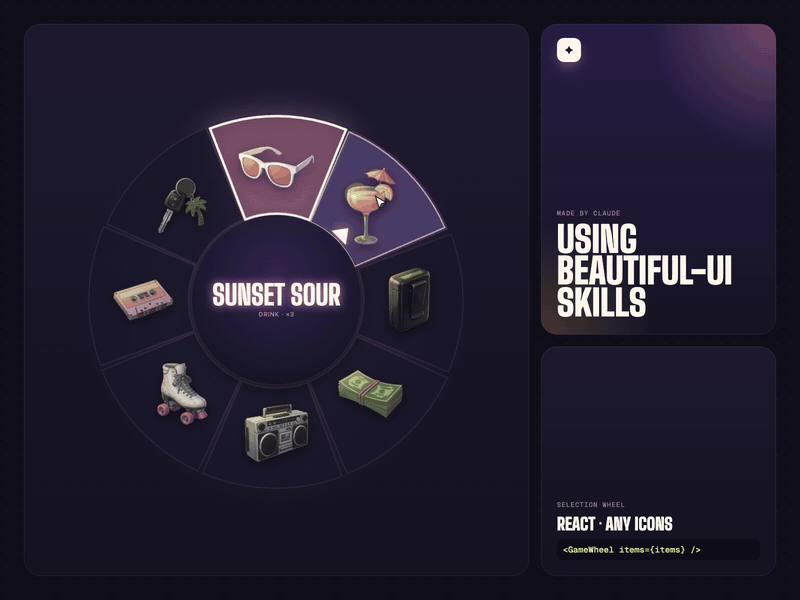

# Game Wheel

A game-style radial selection wheel for React. Aim with the cursor or arrow keys, confirm with a click or Enter.
Any items, any icons. No dependencies besides React.



## Install
Copy `GameWheel.tsx` and `game-wheel.css` into your project.

## Use
```tsx
import { useState } from 'react';
import { GameWheel, type WheelItem } from './GameWheel';

const items: WheelItem[] = [
  { id: 'shades', label: 'Shades', icon: '/icons/shades.webp', meta: 'Look · rare' },
  { id: 'keys', label: 'Car keys', icon: '/icons/keys.webp', meta: 'Convertible' },
  // 3–12 items work best
];

export function Inventory() {
  const [pick, setPick] = useState('shades');
  return <GameWheel items={items} value={pick} onChange={setPick} size={480} />;
}
```

## Props
| Prop | Type | Default | |
|---|---|---|---|
| `items` | `WheelItem[]` | — | `{ id, label, icon?, render?, meta?, disabled? }`. Use `render` for SVG icons or your own node. |
| `value` / `defaultValue` | `string` | first item | Controlled / uncontrolled selection. |
| `onChange` | `(id) => void` | — | Fires on click or Enter. |
| `onAim` | `(id) => void` | — | Fires while aiming: previews, sounds, haptics. |
| `size` | `number` | `440` | Diameter in px (never exceeds its container). |
| `label` | `string` | `"Select an item"` | Accessible name. |
| `theme` | `{ bg, slot, slotAim, slotActive, stroke, glow, text, muted }` | sunset night | Or set the `--gw-*` CSS variables. |

## How it behaves
- Aims by angle with a dead zone in the centre, like a thumbstick.
- Two states: aimed (lighter slot, bigger icon) and selected (outline + glow). The centre shows the aimed label.
- Springy entrance; respects `prefers-reduced-motion`.
- Keyboard: ←/→/↑/↓, Home, End, Enter, Space (a real listbox with `aria-activedescendant`).

## License
MIT · by [@emexmiguel](https://x.com/emexmiguel)
